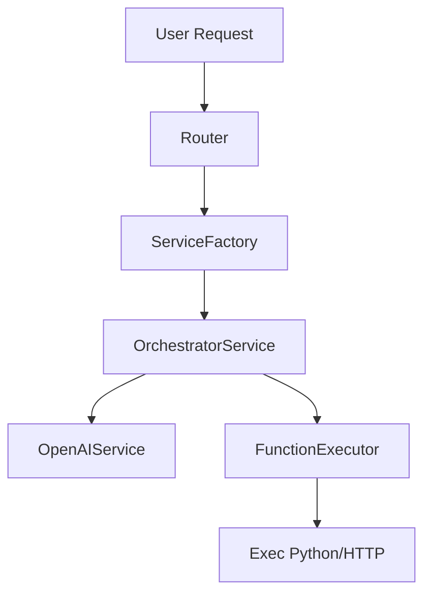

# 🧠 APIchat: AI-Powered Automation Platform

Welcome to **APIchat**, a platform designed to orchestrate and automate function calls using OpenAI and user-defined APIs. It includes MCP integrations, function execution, proxy management, session tracking, and user-based access control.

---

## 📦 Project Structure

```
app/
├─ core/
│  ├─ service_factory.py     # Main DI container
│  └─ ...
├─ models/                   # SQLAlchemy models
├─ schemas/                  # Pydantic schemas
├─ services/
│  ├─ orchestrator_service.py   👑 Main brain of the app
│  ├─ openai_service.py         💬 Manages OpenAI calls
│  ├─ function_service.py       🔧 Function CRUD
│  ├─ executor.py               ⚙️ Executes Python or HTTP functions
│  ├─ database_service.py       🧬 LangChain database integration
│  ├─ chat_history_service.py   💭 Chat memory
│  ├─ proxy_service.py          🌐 Proxy CRUD + link to functions
│  ├─ mcp/                      🔌 Modular Connector Providers
│  │  ├─ mcp_integration_service.py
│  │  └─ ...
│  └─ ...
├─ routers/
│  ├─ openai.py, functions.py, mcp.py, etc.
└─ main.py
```

---

## 🔄 Execution Flow



---

## ⚙️ Main Services

### OrchestratorService 👑
- Main control service
- Connects user, DB, app, agent, OpenAI, and function execution
- Triggers FunctionExecutor when OpenAI requests function calling

### FunctionExecutor ⚙️
- Executes local Python code via `exec()` securely
- Or sends HTTP requests with templated headers/body
- Supports rendering arguments in headers/body using `.format()`

### OpenAIService 💬
- Handles prompt creation and token usage
- Decides whether to call a function
- Returns assistant responses or triggers executions

### MCPIntegrationService 🔌
- CRUD for MCP tools (external connectors)
- Stores metadata and type of integration
- Injected dynamically at runtime

### ProxyService 🌐
- Manages proxy definitions
- Linked to functions to route HTTP requests properly

---

## 🧑‍💻 Authentication & Factory

- `ServiceFactory` handles:
  - Database session
  - User resolution from cookies/session
  - Dependency injection per request

---

## 🛡️ Roles & Permissions (Coming Soon)

- Roles will define allowed scopes:
  - `admin`, `developer`, `viewer`, etc.
- Permissions will be attached to:
  - Strategies
  - Apps
  - MCP Integrations
  - Proxies
- User roles will be stored in DB

---

## 📋 Healthcheck & Versioning

- `GET /health`: Checks DB and service status ✅
- `GET /version`: Returns current API version 🔖

---

## 💳 Stripe Integration (Planned)

- Will be added under `services/payments/stripe_service.py`
- Used for billing, usage tracking, and limits

---

## 📜 License

This project is proprietary and intended for internal use or enterprise deployment only.
