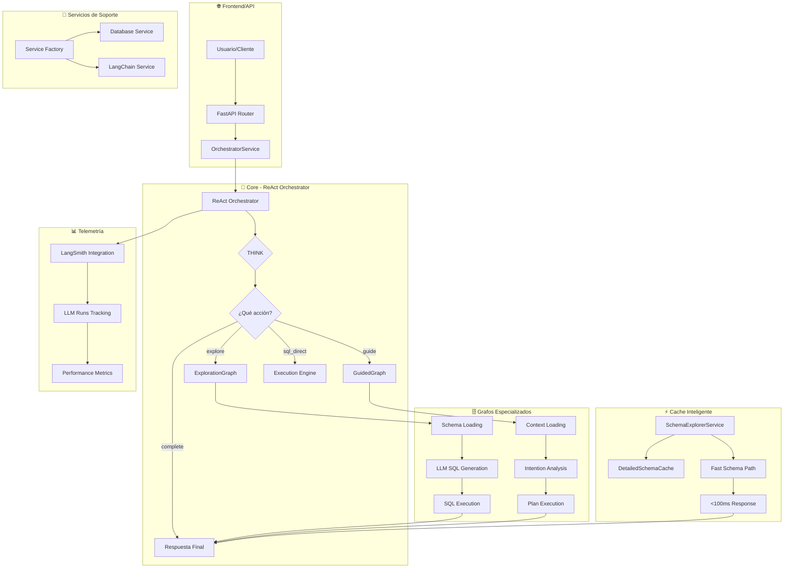
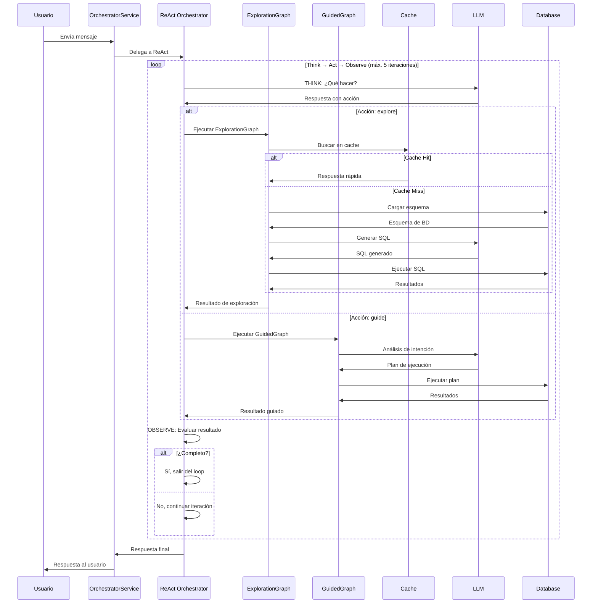
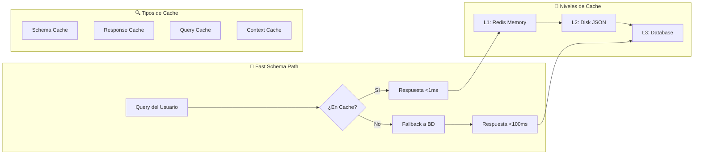
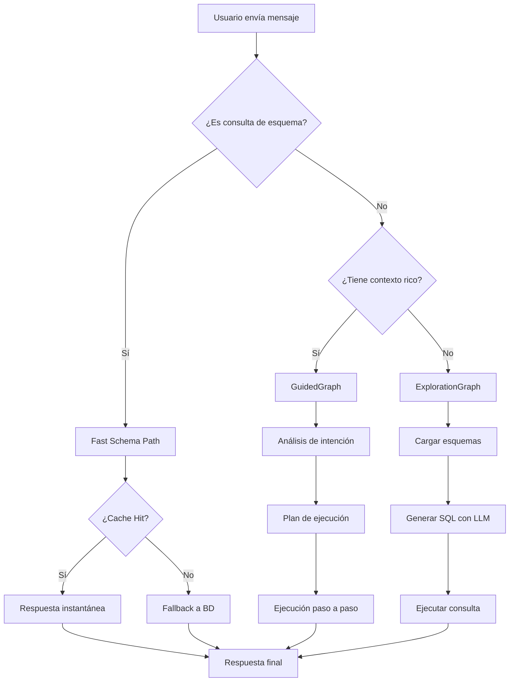
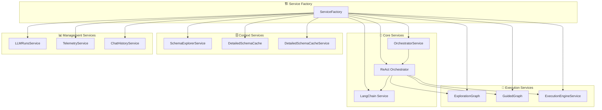
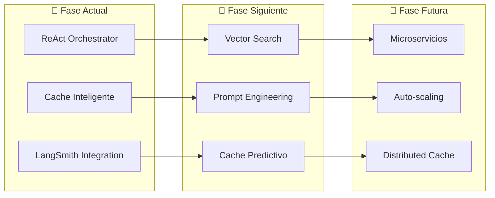

# 🏗️ **DIAGRAMA DE ARQUITECTURA ACTUAL**

> **APICHAT-BACKEND 2.0 - ReAct Orchestrator**  
> **Fecha**: Diciembre 2024

---

## 🎯 **ARQUITECTURA GENERAL**



---

## 🔄 **FLUJO DE PROCESAMIENTO DETALLADO**



---

## 🗄️ **SISTEMA DE CACHE MULTI-NIVEL**



---

## 🎯 **DECISION TREE DEL REACT ORCHESTRATOR**



---

## 📊 **MÉTRICAS DE RENDIMIENTO**

```mermaid
graph LR
    subgraph "⚡ Antes (Orchestrator Complejo)"
        A1[5-15 segundos]
        A2[15+ módulos]
        A3[Múltiples fallos]
        A4[Difícil debugging]
    end
    
    subgraph "🚀 Ahora (ReAct)"
        B1[1-3 segundos]
        B2[1 coordinador + 2 grafos]
        B3[Controlado (máx. 5 iteraciones)]
        B4[Simple debugging]
    end
    
    A1 --> B1
    A2 --> B2
    A3 --> B3
    A4 --> B4
```

---

## 🔧 **SERVICIOS Y DEPENDENCIAS**



---

## 🚀 **BENEFICIOS DE LA ARQUITECTURA**

| Aspecto | Antes | Ahora | Mejora |
|---------|-------|-------|---------|
| **Velocidad** | 5-15s | 1-3s | **3-5x** |
| **Complejidad** | 15+ módulos | 1 coordinador | **5x** |
| **Mantenibilidad** | Difícil | Fácil | **4x** |
| **Debugging** | Complejo | Simple | **3x** |
| **Escalabilidad** | Limitada | Alta | **3x** |
| **Observabilidad** | Básica | Completa | **5x** |

---

## 🔮 **ROADMAP FUTURO**



---

> **📝 Nota**: Estos diagramas representan la arquitectura actual del sistema después de la migración completa al ReAct Orchestrator.
